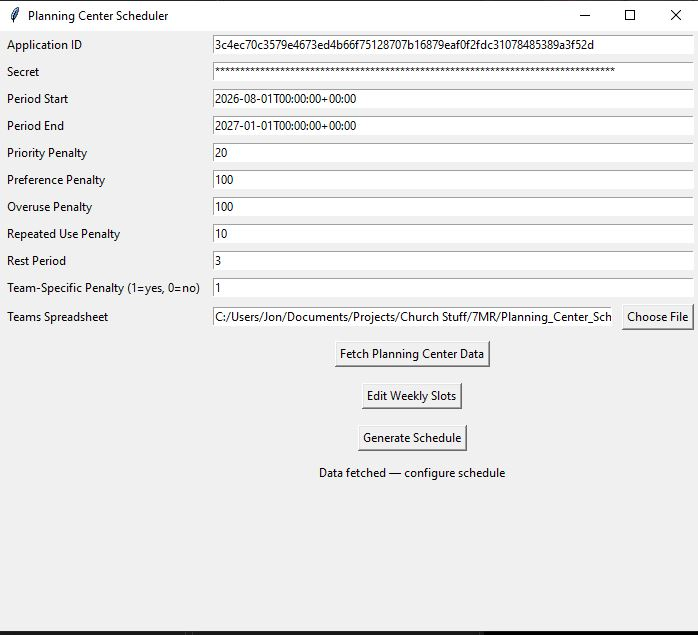
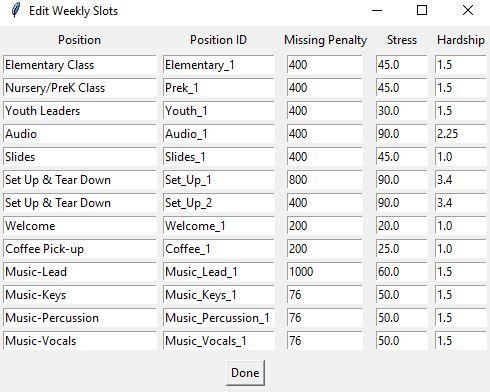

# Planning Center Scheduler

A volunteer scheduling optimizer community teams that use [Planning Center Services](https://www.planningcenter.com/). It pulls people, blockout dates and scheduling preferences from the Planning Center API, then builds the schedule with constraint programming (Google OR-Tools CP-SAT), balancing coverage, volunteer preferences, and user defined/mapped fairness.

## Use Case

Scheduling dozens of volunteers across multiple teams each week is a combinatorial problem. A good schedule must:

- fill every position where possible
- respect blockout dates
- avoid overworking anyone
- avoid pigeonholing anyone into a certain role
- honor "serve with" and "don't serve with" preferences

Doing this by hand is slow and is error prone

## Approach

The scheduler is a constraint-optimization model with a binary decision variable for each (slot, volunteer) pair. It minimizes a weighted sum of penalties.

**Hard constraints**
- Each slot has at most one volunteer.
- A volunteer works at most one slot per day.
- Volunteers with a blockout on a date are not eligible for that date.
- Volunteers are only eligible for teams and positions they are listed under.

**Soft constraints (penalties)**

| Penalty | Purpose |
| --- | --- |
| Empty slot | Discourages unfilled positions; weighted per position; lower penalties denote that it is optional|
| Position stress | Spreads high-stress positions around (stress x hardship factor) |
| Priority | Prefers volunteers ranked higher for a position |
| Overuse | Penalizes serving more than once in a rolling window (`rest_period` weeks); the first assignment is free |
| Repeated use | Lightly encourages spreading assignments across volunteers |
| Team repetition | Discourages pigeonholing someone into one role; scales with position stress |
| Preference violation | Penalizes broken "serve with" or "don't serve with" preferences |

All weights are configurable, so each organization can trade off coverage, fairness and preferences.

## Project structure

| File | Role |
| --- | --- |
| `App.py` | Tkinter GUI for entering credentials, dates, penalty weights and the teams spreadsheet |
| `Create_Schedule.py` | Orchestrates data fetching, model building and solving |
| `Planning_Center_Functions.py` | Planning Center API client: people, blockouts, preferences |
| `Schedule_Functions.py` | `PCScheduler` class: variables, constraints, penalties and solver |

## Setup

```bash
git clone https://github.com/jonchen1994/planning_center_scheduler
cd planning_center_scheduler
pip install pandas numpy requests tqdm ortools openpyxl
```

1. Create a Planning Center personal access token (Application ID and Secret).
2. Create `config.json` in the project folder. Do not commit it; it is listed in `.gitignore`.

```json
{
  "APP_ID": "your-app-id",
  "SECRET": "your-secret",
  "PERIOD_START": "2026-01-04",
  "PERIOD_END": "2026-03-29",
  "Updated_Teams_List": "teams.xlsx",
  "priority_penalty": 20,
  "preference_violation_penalty": 100,
  "OVERUSE_PENALTY": 100,
  "REPEATED_USE_PENALTY": 10,
  "rest_period": 3,
  "team_specific_penalty": 0,
  "weekly_slots": [
    {
      "position": "Team-Position",
      "position_id": "example_1",
      "missing_penalty": 500,
      "position_stress": 10,
      "hardship_factor": 1
    }
  ]
}
```

3. Prepare a teams spreadsheet (`.xlsx` or `.csv`) with the columns `Team_Name`, `Position`, `Full_Name` and `Priority`.

## Usage

```bash
python App.py
```

Enter your settings, choose the teams spreadsheet, and run. The result is a table of positions by day, saved as CSV.

## Results






## Limitations and next steps

- Schedules are built for Sundays only currently.
- Name matching assumes first and last names; names with middle names are not handled.
- Add progress communication to UI
- Add functionality to edit weekly slots from UI